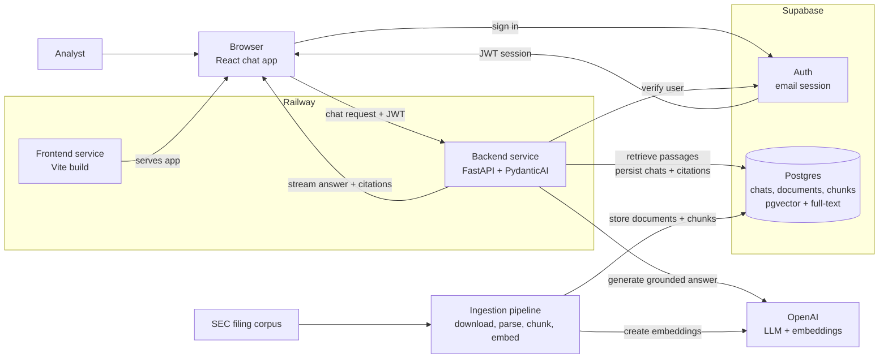

# Docpilot Architecture

## Purpose

Docpilot is an internal research assistant for analysts who need grounded answers from a curated SEC filing corpus. The architecture must optimize for trust: every answer is generated from retrieved source passages, every factual claim is citable, and the system fails clearly when the corpus does not support an answer.

This document describes the target architecture for the chat experience, LLM orchestration, and the communication layer between the React SPA, Supabase, and FastAPI backend.

## High-Level Architecture

The best opening diagram is a service-level view that shows the two core paths: the live chat path that serves users, and the ingestion path that prepares SEC filings for retrieval.



## Architectural Goals

- Keep the browser thin: it renders chat state, manages the user's Supabase session, and streams assistant responses.
- Keep the backend authoritative: retrieval, grounding, citation checks, tool execution, and database writes happen in FastAPI.
- Use Supabase for identity and durable product state: users, chat threads, source documents, chunks, embeddings, and citation metadata.
- Use Supabase `pgvector` for semantic retrieval and Postgres full-text search for keyword retrieval.
- Make the LLM path typed and testable by using PydanticAI agents with explicit dependencies, outputs, and tool boundaries.
- Preserve a simple deployment model on Railway: one frontend service, one stateless backend service, and hosted Supabase.

## Stack

Frontend:

- Vite + React SPA + TypeScript
- React Router for routing
- Tailwind CSS and shadcn/ui for UI
- `@supabase/supabase-js` for browser auth
- Vercel AI SDK UI packages for chat state and streaming client behavior

Backend:

- Python 3.12+
- FastAPI + Uvicorn
- Pydantic v2 + pydantic-settings
- PydanticAI for typed LLM orchestration
- OpenAI SDK for generation and embeddings
- Supabase Python client for server-side database access
- SQLAlchemy models + Alembic migrations for schema management; SQLAlchemy
  also carries ingestion's writes and retrieval's reads (see [Corpus
  Ingestion](#corpus-ingestion) and [Retrieval Strategy](#retrieval-strategy))
- Supabase `pgvector` for semantic search
- Postgres full-text search for lexical retrieval
- `httpx` for outbound HTTP
- `structlog` for structured logs

Persistence:

- Supabase Auth for email login
- Supabase Postgres for user records, chat threads, chat messages, source documents, chunks, embeddings, full-text search vectors, and citation metadata

## System Boundaries

The frontend is responsible for user interaction, local UI state, and sending the authenticated user's request to the backend. It should never hold service-role credentials, run retrieval logic, call OpenAI directly, or write privileged records to Supabase.

The backend is responsible for request authorization, retrieval, prompt construction, LLM execution, citation validation, streaming responses, and durable persistence. It owns all privileged credentials and is the only service allowed to use the Supabase service-role key.

Supabase is responsible for authentication and durable product state. Browser access uses the anon key and user JWT. Server access uses either the user's bearer token for user-scoped operations or the service-role key for privileged writes that must still be explicitly tied to the authenticated user. The filing corpus is the exception: the backend reads and writes it over its own Postgres connection (`DATABASE_URL`), which no user's key can reach.

## Request Flow

1. The user signs in with Supabase email auth in the React SPA.
2. The frontend stores the Supabase session through `@supabase/supabase-js`.
3. When the user opens a chat, the frontend loads the thread and prior messages through FastAPI, which reads user-scoped records from Supabase.
4. The chat UI uses the Vercel AI SDK React primitives to manage message state and submit new user messages to the FastAPI chat endpoint.
5. The frontend sends the Supabase access token as `Authorization: Bearer <token>`.
6. FastAPI verifies the token with Supabase Auth before doing any retrieval or LLM work.
7. FastAPI creates a request-scoped context containing the authenticated user, chat thread, Supabase client, retrieval service, citation policy, and LLM settings.
8. A PydanticAI agent retrieves relevant document chunks, generates a grounded answer, and returns typed output containing answer text and citations.
9. FastAPI streams assistant message parts back to the browser in the format expected by the AI SDK client.
10. FastAPI persists the final user message, assistant message, cited chunks, and usage metadata to Supabase.

## Frontend Chat Layer

The frontend remains a plain Vite SPA. It should not adopt Next.js route handlers or server components. The AI SDK is used only for its React chat primitives and streaming client behavior.

The chat module should be organized around these responsibilities:

- `src/lib/env.ts` validates `VITE_API_BASE_URL`, `VITE_SUPABASE_URL`, and `VITE_SUPABASE_ANON_KEY`.
- `src/lib/supabase.ts` creates the browser Supabase client.
- `src/lib/http.ts` wraps `fetch`, applies the backend base URL, injects the Supabase bearer token, handles timeouts, and converts failures into typed API errors.
- `src/lib/api.ts` exposes product-level calls such as loading threads, creating threads, and fetching message history.
- `src/pages/chat/*` renders chat routes and delegates chat streaming to a focused chat component.
- `src/components/chat/*` renders messages, citations, source passages, empty states, and streaming status.

The chat component should initialize with stored messages and then let the AI SDK manage in-flight UI state. The transport points to FastAPI, not to a frontend server route.

Conceptual shape:

```ts
const { messages, sendMessage, status, error } = useChat({
  id: threadId,
  messages: initialMessages,
  transport: new DefaultChatTransport({
    api: `${apiBaseUrl}/chat/stream`,
    headers: async () => ({
      Authorization: `Bearer ${await getAccessToken()}`,
    }),
  }),
});
```

The exact API surface should be verified during implementation against the installed AI SDK version. The architectural rule is stable: the browser streams to FastAPI with the user's Supabase token, and FastAPI owns the assistant run.

## Backend LLM Layer

PydanticAI should be introduced as the backend's orchestration layer for answer generation. It replaces ad hoc prompt calls with a typed agent boundary.

Recommended backend modules:

```text
backend/app/
├── api/
│   ├── chat.py                 # POST /chat/stream
│   └── threads.py              # Thread list/create/history, and the ownership guard
│                               # `/chat/stream` reuses. Split out of chat.py: the
│                               # thread routes are plain JSON CRUD and share nothing
│                               # with streaming but that guard.
├── auth/
│   └── dependencies.py         # Supabase JWT verification and current user dependency
├── chat/
│   ├── orchestrator.py         # Coordinates one chat turn end-to-end
│   ├── messages.py             # Converts AI SDK messages to and from internal message types
│   └── streaming.py            # Emits AI SDK-compatible streaming events
├── assistant/
│   ├── agent.py                # PydanticAI agent definition
│   ├── deps.py                 # Runtime dependency dataclass for the agent
│   ├── outputs.py              # GroundedAnswer, Citation, and SourcePassage
│   └── instructions.md         # System instructions and product contract
├── retrieval/
│   ├── queries.py              # pgvector and full-text SQL queries
│   ├── fusion.py               # Reciprocal Rank Fusion for hybrid search
│   └── retriever.py            # Query-to-source-passage retrieval logic
├── grounding/
│   └── validator.py            # Ensures citations map to retrieved passages
└── database/
    ├── supabase.py             # Supabase client construction
    ├── engine.py               # SQLAlchemy engine over `DATABASE_URL`, and the
    │                           # session-connection guard Alembic and ingestion share
    ├── models/                 # SQLAlchemy table models used by Alembic autogenerate,
    │                           # one module per table over a shared `base.py`
    ├── chats.py                # Chat, thread, message, and citation persistence
    └── documents.py            # Filing and chunk reads: slice lookup, and each
                                # passage with its context
```

The retrieval eval lives beside `app/`, like ingestion: `backend/evals/` (see
[Retrieval Evaluation](#retrieval-evaluation)).

Ingestion is not part of the app: it is a CLI in `backend/ingest/`, beside `app/`
(see [Corpus Ingestion](#corpus-ingestion)).

These names should follow the product workflow rather than a generic service layer. `chat/orchestrator.py` owns the full turn lifecycle, `assistant/agent.py` owns the LLM boundary, `retrieval/` owns hybrid source-passage search, and `grounding/` owns the trust contract that answers must cite retrieved evidence.

The agent should receive explicit dependencies rather than reaching into globals:

```python
@dataclass
class DocumentAgentDeps:
    user_id: str
    thread_id: str
    retriever: DocumentRetriever
    grounding_validator: GroundingValidator


class GroundedAnswer(BaseModel):
    answer: str
    citations: list[Citation]
    cited_passages: list[SourcePassage]
```

The agent's instructions should encode the product contract:

- Answer only from retrieved passages.
- Cite every factual claim.
- If the retrieved context is insufficient, say that the corpus does not contain enough evidence.
- Do not provide stock recommendations or investment advice.
- Keep answers concise enough for analyst review, but include enough cited passages to verify the answer.

Retrieval and grounding remain independent from PydanticAI. This keeps ingestion, retrieval tests, and citation validation testable without invoking the LLM.

## Corpus Ingestion

`backend/ingest/` turns the downloaded filings into what retrieval searches. Run
it from `backend/` after `uv run data/download.py`:
`uv run python -m ingest [--ticker AAPL] [--dry-run]`.

```text
data/downloads/*.htm      inline-XBRL XHTML, one 10-K each
  → xhtml.py, tables.py   normalized Markdown        → source_documents.markdown
  → chunker.py            chunks, a pure function of that Markdown
  → embed.py              text-embedding-3-small     → document_chunks.embedding
  → store.py              one transaction per filing
```

- **The Markdown is the contract.** It is stored, and the chunker reads nothing
  else, so chunking can be re-tuned without the HTML. Its format — Item headings,
  page markers, table blocks — is specified in `ingest/markdown.py`.
- **The citation unit is the Item section plus the printed page.** `section` is
  the 10-K Item ("Item 7. Management's Discussion and …"), titled from a fixed
  table so every filer reads the same. `page` is the number the filing prints in
  that page's own footer — `"23"`, `"F-12"`, or `"22–23"` for a chunk that runs
  across a page break — and null where a page prints none. It is never counted
  or guessed, so an analyst can turn to it in the filing.
- **Chunks never cross an Item.** About 500 tokens, 800 at most, overlapping by
  whole sentences. A table stays whole under the maximum; a larger one is split
  by rows, and each piece repeats the header and the group label ("North
  America") its rows sit under. Text before Item 1 — the cover page and table
  of contents — is stored but not chunked.
- **Every chunk can be checked against its filing.** `content` is a short prefix
  (a repeated table header, or nothing), then one contiguous stretch of the
  stored Markdown: `content[prefix_len:] == strip_markers(markdown[start:end])`,
  with `prefix_len`, `start` and `end` kept in the chunk's metadata.
  `chunker.verify` holds every chunk to that, and to the Item its offsets fall
  in, before anything is stored.
- **A filing that fails a check is not stored.** A missing Item heading, or page
  labels that skip backwards or cover under 90% of pages, raises `FilingError`;
  the run reports the filing and moves on. Sections that were quietly wrong
  would still produce confident, well-cited answers.
- **Embeddings see a context line** ("Apple Inc. — 10-K FY2024 — Item 7. …")
  that `content` does not hold, so a passage that never names its company or
  year still matches a question that does, while full-text search and citations
  see only the passage.
- **Writes use SQLAlchemy over `DATABASE_URL`, not PostgREST.** Replacing a filing
  is an upsert on `accession_number`, a delete of its chunks and an insert of the
  new ones, which must commit together; PostgREST gives each request a
  transaction of its own. The upsert keeps the document's id, so past citations
  keep their `document_id` (their `chunk_id` goes null, and they render from
  their own copy of the passage). A full run ends with `VACUUM ANALYZE`.
- **Re-embedding is a command.** The 25-filing sample is ~4,200 chunks and ~1.7M
  tokens: a full run takes a few minutes and costs about $0.04 in embeddings.

## Retrieval Strategy

Docpilot uses hybrid retrieval, fanned out by filing. `retrieve(query, slices)`
in `app/retrieval/retriever.py` takes a query and the slices it concerns — a
slice is one company's filing for one fiscal year, `(ticker, fiscal_year,
form_type)` — and runs the whole search once per slice:

1. Embed the query with the configured OpenAI embedding model, the one the corpus was embedded with.
2. Resolve each slice through `source_documents (ticker, fiscal_year)` to its filing. A slice the corpus has no filing for comes back with no filing and no passages, rather than disappearing.
3. Rank each filing's chunks twice: by cosine distance over `document_chunks.embedding` with `pgvector`, and by full-text match over `document_chunks.search_vector`. Each is one statement for every filing — a lateral join runs a bounded top-n per filing — so a query over twenty filings costs one round trip per search.
4. Fuse each filing's two rankings in Python with Reciprocal Rank Fusion.
5. Read the best `k` with their context (`app/database/documents.py`): the filing's metadata but never its Markdown, the chunk either side of each, and every part of a split table, since a later piece repeats the header but not the rows above it.

The reasons behind each step:

- **Fan out, because flat top-k silently narrows.** One top-k over the corpus
  clusters on the one or two filings that match best, and "across Apple's
  2021–2025 10-Ks" gets answered from two years. Per-slice results make the
  coverage explicit. Which slices a question needs is the caller's decision:
  the eval names them per question, and M4's `search_filings` tool chooses them.
- **Search each topic, not only the question.** A question that names several
  topics ("demand drivers, customer concentration, and supply constraints")
  embeds as an average of them, so passages about any one rank below passages
  touching several. Searched as written, the brief's ten questions find 163 of
  the eval's 215 evidence strings; with one more search per topic they name,
  210. The agent is to search the same way, and to search for a statement line
  item by its own name ("cash flow statement: purchases of property and
  equipment"), since no cash flow statement says "capital expenditures".
- **Keyword search ORs the query's words**, ranked by `ts_rank_cd`.
  `plainto_tsquery` and `websearch_to_tsquery` both require every word, and no
  passage contains every word of a whole question: brief question 1 matches
  nothing either way. Words are split on anything but letters and digits first,
  because Postgres parses "subscriptions/platforms/devices" as a single file-path
  lexeme. Stemming and stop words are left to the `english` configuration the
  index was built with. Ranked without IDF, OR-ed words reward a chunk for
  repeating any of them, however common, which is why semantic rank counts
  double in the fusion (see [Retrieval Evaluation](#retrieval-evaluation)).
- **`SET LOCAL hnsw.iterative_scan = relaxed_order`** runs in the vector
  search's transaction. The HNSW index (pgvector 0.8.2) filters after it
  searches. On a plan that scans the index for one filing's chunks, it finds
  the corpus's 40 nearest (`hnsw.ef_search`) and keeps that filing's few: across
  all 25 filings, 40 chunks came back in total. An iterative scan keeps going
  until each filing has its `k`. Left to itself, the planner currently scans each
  filing's chunks exactly instead, but that is a plan choice, not a guarantee.
  `tests/retrieval/test_live_search.py` forces the index plan and holds every
  filing to a full `k`.
- **Filters sit on the filing, not the chunk.** A slice resolves to a
  `document_id`, which the chunk searches filter on through
  `uq_document_chunks_document_id_chunk_index`. Each chunk's `metadata` repeats
  `ticker`, `fiscal_year` and `form_type` for anything that needs a JSONB filter
  (`fiscal_year` is an integer, and `@>` compares types).
- **NVIDIA's financial statements are in Item 15**, not Item 8: its Item 8 is
  one sentence pointing there. Nothing may narrow a financial question to
  Item 8. NVIDIA's capital expenditures and customer concentration, in the
  eval, are found in Item 15.

This keeps the database responsible for efficient ranked retrieval and the application responsible for product-specific ranking policy. The first implementation avoids agent-generated SQL; the PydanticAI agent receives bounded tools such as `search_filings`, `read_chunk`, and `read_surrounding_chunks`.

## Retrieval Evaluation

`backend/evals/brief.py` is retrieval's regression net. It holds the brief's ten
questions exactly as the brief words them, the filings each concerns, and, for
each filing, the evidence an analyst would need. That is a figure where the
answer is a number, or a sentence where it is a disclosure, copied from the
filing: Apple FY2024's "201,183" is iPhone net sales. Evidence is text, not chunk
ids, because ids change on every re-ingest. There are 215 strings over 76 filing
searches, and every run also checks each string against its own filing, so a
typo cannot pass for a retrieval miss. `evals/harness.py` does the scoring.

```bash
uv run python -m evals.brief          # recall per question and filing, the rank of each find, where each miss is
uv run python -m evals.brief --k 12   # the same at another k
uv run pytest -m integration          # holds each question to its minimum
```

A string counts as found when a returned passage or its context holds it, since
M4's model reads both. **Any change to chunking or retrieval re-runs the eval**,
and a question that falls below its `minimum` fails `tests/evals/test_brief.py`.

The values in `app/retrieval/retriever.py` were tuned on 2026-09-24. Each
filing's full semantic and keyword rankings were replayed offline, every
setting was re-scored, and the choice was confirmed live (210 of 215, as
replayed):

| Setting | Value | Why |
|---|---|---|
| `K`, passages per filing and search | 10 | 201 of 215 at 8, 210 at 10, 213 at 12, 214 at 16. Each passage added costs about 850 tokens per filing, context included |
| `CANDIDATES`, each search's top-n before fusion | 20 | Best at `k` 10 and 12 (210, 213). At 30, keyword matches on common words crowd out better semantic ones: 202 at `k` 10 |
| `SEMANTIC_WEIGHT` / `KEYWORD_WEIGHT` | 2 / 1 | Equal weights find 205 at `k` 10, and anything from 1.5 to 3 finds 210–212. Question 9 is the swing, 10 of 15 against 15: its geography tables are the top semantic match but a middling keyword one |
| `fusion.K`, RRF's own `k` | 60 | 10, 30 and 60 land within two strings of each other; 60 is the published default |
| Chunk size | ~500 tokens, 800 max: unchanged | Re-chunked offline at 300/500 and at 800/1,200, and embedded afresh. At this cost it is a wash: 211 of 215 in 17,300 tokens per filing (300/500, `k` 20), 203 in 17,000 (800/1,200, `k` 6), against 210 in 16,000 now. Smaller chunks win on a tighter budget: 205 in 12,600 tokens, against 191 in 12,000 |

What else the tuning showed:

- Searched as written, keyword rank adds little: the best hybrid setting found
  168 of 215 at `k` 8 and semantic rank alone 166. With topic searches it pulls
  its weight: "purchase commitments" puts every company's commitments at keyword
  rank 1–5. Dropping corpus-common words from the OR query (those in more than 2
  to 50% of chunks) did not help, at best 174 at `k` 10.
- The context read with each passage roughly doubles what comes back (16,000
  tokens per filing at `k` 10, against 8,800 for the passages alone) and adds 8
  strings. At equal cost, more passages would find more: 208 at `k` 16 with no
  context, in 12,700 tokens. Split-table parts add nothing measurable on this
  corpus, because its split tables have two or three pieces and the neighbours
  already cover them.
- Known misses at `k` 10, each recorded beside its question's `minimum`: NVIDIA
  FY2021's and FY2023's "No customer represented 10% or more of total revenue"
  (question 3). A sentence that there is no concentration ranks below the
  passages that describe customers. Also Apple FY2022's Digital Markets Act
  sentence and Apple FY2025's export controls, which sit in a risk factor about
  hiring (question 6), and NVIDIA FY2023's margin decline from inventory charges
  (question 10).

That cost is what M4 inherits. A single-search question returns 8,000–9,500
tokens per filing: about 40,000 for five filings. The multi-topic questions
return far more: question 8 about 480,000 (20 filings, 3 searches), question 6
about 410,000 (25 filings, 6 searches), question 10 about 290,000. The agent's
per-question budget, the "multi-year fan-out cost" question in `todos.md`, has to
cut that. The levers, with their scores above: fewer passages per topic search,
context on request through `read_surrounding_chunks` rather than every time, or
smaller chunks.

## Supabase and FastAPI Communication

Supabase Auth is the identity source. FastAPI must treat the browser's Supabase JWT as the request credential.

Frontend rules:

- Use the anon key only in the browser.
- Read the current session through the shared Supabase client.
- Send the access token to FastAPI through the shared API client.
- Never pass tokens through component props.
- Never expose the service-role key to the frontend.

Backend rules:

- Verify `Authorization: Bearer <token>` at the FastAPI boundary.
- Reject unauthenticated requests before retrieval or LLM work.
- Derive `user_id` and email from the verified Supabase user.
- Use user-scoped database operations wherever possible.
- Use the service-role key only on the backend for privileged writes that cannot be safely performed with the anon key.
- The filing corpus is the one exception to both rules, and it is readable by the backend only. `source_documents` and `document_chunks` have RLS enabled and no read policies, so no user's key reaches them. Retrieval reads them over the backend's own connection (`DATABASE_URL`, `app.state.database_engine`), which is also how ingestion writes them. It is no one user's data, so there is nothing to scope a read to.
- Always attach persisted chat records to the authenticated `user_id`.

The backend can verify the JWT by calling Supabase Auth's user endpoint or by validating the project's JWT signing keys. For the first implementation, calling Supabase Auth is simpler and avoids local JWT validation mistakes. If request volume grows, local JWT verification can be added behind the same `AuthService` interface.

Recommended backend units:

- `app/auth/dependencies.py` validates bearer tokens and exposes `get_current_user`.
- `app/database/supabase.py` creates user-scoped and admin Supabase clients.
- `app/database/chats.py` stores and reads chat threads, messages, and citation records.
- `app/database/documents.py` reads source documents and chunks for retrieval; `ingest/store.py` writes them.

## Streaming Contract

The frontend should receive incremental assistant output, not wait for a full answer. FastAPI should expose a streaming endpoint that emits AI SDK-compatible message parts.

Recommended endpoint:

```text
POST /chat/stream
Authorization: Bearer <supabase_access_token>
Content-Type: application/json
```

Request body:

```json
{
  "threadId": "uuid",
  "messages": []
}
```

The `messages` payload uses the AI SDK UI message format. Only the last user
message is read: the thread's history lives in Postgres, and rebuilding a prompt
from the browser's copy would let a caller rewrite what was previously asked and
answered through a request body. The SDK also sends `id`, `trigger` and
`messageId`, which describe a chat session the backend does not track; they are
ignored.

Response headers:

```text
content-type: text/event-stream
x-vercel-ai-ui-message-stream: v1
cache-control: no-cache
x-accel-buffering: no
```

`x-accel-buffering` matters in deployment: a reverse proxy that buffers the body
turns a stream into one late blob. The protocol-version header is what the
client is written against — but the SDK's transport does not read it back, so it
does not need adding to the CORS `expose_headers`.

Parts, verified against `ai@7.0.107` (`UIMessageChunk` in `node_modules/ai/dist`):

```text
data: {"type":"start","messageId":"…"}
data: {"type":"text-start","id":"…"}
data: {"type":"text-delta","id":"…","delta":"Gross "}
data: {"type":"text-end","id":"…"}
data: {"type":"finish"}
data: [DONE]
```

The `id` on the text parts scopes a block of text within one message, so a
single-block answer reuses the message id. `[DONE]` is what the SDK's own server
sends; its parser skips the frame. The part names move between SDK releases —
`tests/chat/test_streaming.py` pins them.

Streaming responsibilities:

- Send text deltas as the answer is generated.
- Send citation/source metadata as structured parts once available.
- Report failures as `{"type":"error","errorText":"…"}`. Authentication, a
  missing thread and a foreign thread all resolve before the first byte and stay
  real status codes (401/404/403); anything after that cannot, because the
  status line is gone. `useChat` surfaces an error part on `error` and stops.
- Persist only after the assistant run completes successfully, unless a separate
  partial-message model is deliberately introduced later. Persistence therefore
  runs *before* `finish` is sent: a write that failed afterwards could no longer
  be reported. The cost is that a failed turn also drops the user's question.
- Store the question and the answer in one insert, so a turn is kept whole or not
  at all — two writes would leave an unanswered question behind whenever the
  second failed, or the browser left between them. A new thread's title is
  written first, so the turn itself is the last write that can fail, and an
  `error` part always means nothing of the turn was stored.

Threads are created untitled and named from their first question, so the sidebar
has something to show. `chat_threads.updated_at` is moved by database triggers
(migrations 0002 and 0003) rather than by the orchestrator — a trigger is the
only place the rule holds for every writer.

## Data Model

Supabase tables should be small and product-oriented:

- `users`: one row per authenticated user in `public`, keyed by Supabase `auth.users.id`.
- `chat_threads`: thread metadata, owner, title, timestamps.
- `chat_messages`: user and assistant messages in order, with AI SDK-compatible message JSON where useful.
- `message_citations`: normalized citation records linked to assistant messages.
- `source_documents`: original document records with filing metadata, source URL, and normalized Markdown content.
- `document_chunks`: chunk text, chunk metadata, embeddings, and generated full-text search vectors.

A `public.users` row is created by a backend upsert on the first authenticated request, not by a database trigger on `auth.users`. The upsert is testable without a live Supabase instance, and it keeps row creation in the same code path that already validates the JWT. `public.users.id` is a foreign key to `auth.users.id` with `on delete cascade`, so deleting the auth user removes the application row and everything owned by it.

`source_documents` stores the normalized Markdown version of each filing so the application can re-chunk, inspect, and cite the original extracted text without reaching back into downloaded HTML files. `document_chunks` stores retrieval-ready passages:

- chunk ID
- document ID
- chunk index, contiguous within a document
- `section` (the 10-K Item) and `page` (the printed page label, or null) — the citation unit, see [Corpus Ingestion](#corpus-ingestion)
- chunk text
- embedding vector
- generated `tsvector` for full-text search
- token count
- metadata JSON: the retrieval filters `ticker`, `company`, `form_type`, `fiscal_year` (an integer — JSONB `@>` compares types) and `accession`; `chunk_type` (`text` or `table`), with `table_part` / `table_parts` on the pieces of a split table; and the source offsets `prefix_len`, `start`, `end`

How retrieval uses these columns is in [Retrieval Strategy](#retrieval-strategy).

## Schema Management

Database schema changes are managed from the backend with SQLAlchemy models and Alembic migrations. Supabase is the hosted Postgres database, but the Supabase dashboard is not the source of truth for table definitions.

The workflow is:

1. Update SQLAlchemy models in `app/database/models/`.
2. Generate a candidate migration with `uv run alembic revision --autogenerate -m "<change>"`.
3. Review the generated migration file in `backend/alembic/versions/`.
4. Add explicit migration operations for Postgres/Supabase features that autogenerate cannot infer reliably.
5. Apply the migration locally or against the linked Supabase database with `uv run alembic upgrade head`.
6. Commit both the model changes and the migration file.

Normal tables and ordinary indexes should be represented in SQLAlchemy models where practical. The following should be written explicitly in migrations with `op.execute()` or carefully reviewed Alembic operations:

- `create extension if not exists vector`
- `vector(1536)` embedding columns if the SQLAlchemy type renderer is not sufficient
- generated `tsvector` columns
- HNSW indexes for vector search
- GIN indexes for full-text search and JSON metadata
- RLS enablement and policies
- functions and triggers, such as the `chat_threads.updated_at` triggers in migrations 0002 and 0003
- grants or Supabase role-specific permissions

Alembic must connect with Supabase's direct/session database connection string. Do not run migrations through the transaction pooler URL, because schema migrations, extension setup, and index creation require session-level database behavior. `session_database_url()` in `app/database/engine.py` refuses it, and Alembic, ingestion and the app all take their URL from there; the latter two need a session connection for psycopg's prepared statements.

## Grounding and Citation Policy

Grounding is part of the architecture, not a prompt preference.

The backend should enforce these invariants:

- Every assistant answer has at least one citation unless the answer explicitly says there is not enough evidence.
- Every citation maps to a retrieved source passage.
- Cited passages include enough metadata for the frontend to show company, filing, date, page or section, and excerpt.
- The model cannot cite documents that were not retrieved for the current request.
- If citation validation fails, the backend returns a controlled failure instead of a polished unsupported answer.

This policy should be covered by backend unit tests around retrieval, citation extraction, and grounding enforcement.

## Error Handling

Expected error classes:

- `401 Unauthorized`: missing, expired, or invalid Supabase token.
- `403 Forbidden`: authenticated user tries to access another user's thread.
- `404 Not Found`: thread or source document does not exist.
- `422 Unprocessable Entity`: invalid request payload.
- `502 Bad Gateway`: upstream LLM or Supabase failure.
- `500 Internal Server Error`: unexpected backend failure.

The frontend should render friendly messages while preserving enough technical detail in logs for debugging. Network and CORS failures should be distinguishable from HTTP failures in the shared API client.

## Configuration

Each service must keep one settings module as the source of truth.

Frontend settings:

- `VITE_API_BASE_URL`
- `VITE_SUPABASE_URL`
- `VITE_SUPABASE_ANON_KEY`

Backend settings:

- `SUPABASE_URL`
- `SUPABASE_ANON_KEY`
- `SUPABASE_SERVICE_ROLE_KEY`
- `DATABASE_URL` for Alembic and direct Postgres access
- `OPENAI_API_KEY`
- `ALLOWED_ORIGINS`
- embedding model name and dimensions

Do not read environment variables directly from components, route handlers, or services. Frontend code should use `src/lib/env.ts`. Backend code should use `app/config.py`.

## Deployment Shape

Railway should run two services:

- Frontend: static Vite build served as a web app.
- Backend: FastAPI service running Uvicorn.

Supabase remains hosted and stores the durable retrieval data. The Railway backend can stay stateless because document chunks, embeddings, full-text search vectors, chats, and citations all live in Supabase Postgres. Raw downloaded filings remain gitignored local ingestion inputs unless a later workflow stores them in object storage.

## Implementation Sequence

1. Scaffold the frontend SPA and backend FastAPI app according to the repo conventions.
2. Add SQLAlchemy models and Alembic migration setup in the backend.
3. Add the initial Alembic migration for `pgvector`, source document, chunk, full-text, chat, and citation tables.
4. Add Supabase Auth in the frontend and token verification in FastAPI.
5. Add the shared frontend API client with automatic bearer-token injection.
6. Add the chat streaming endpoint with a stubbed assistant response.
7. Add AI SDK chat UI on the frontend pointed at FastAPI.
8. Add Markdown ingestion, chunking, embeddings, and Supabase writes.
9. Add semantic search with `pgvector`.
10. Add Postgres full-text search and Python RRF fusion.
11. Add PydanticAI document agent with typed dependencies and typed answer output.
12. Add citation validation and grounding enforcement.
13. Add final UI for citations, source passages, empty states, and errors.

## Non-Goals

- No Next.js, SSR, server components, or frontend route handlers.
- No direct OpenAI calls from the browser.
- No separate managed vector database outside Supabase.
- No multi-tenant architecture.
- No external market/news data.
- No trading recommendations or generated stock picks.
